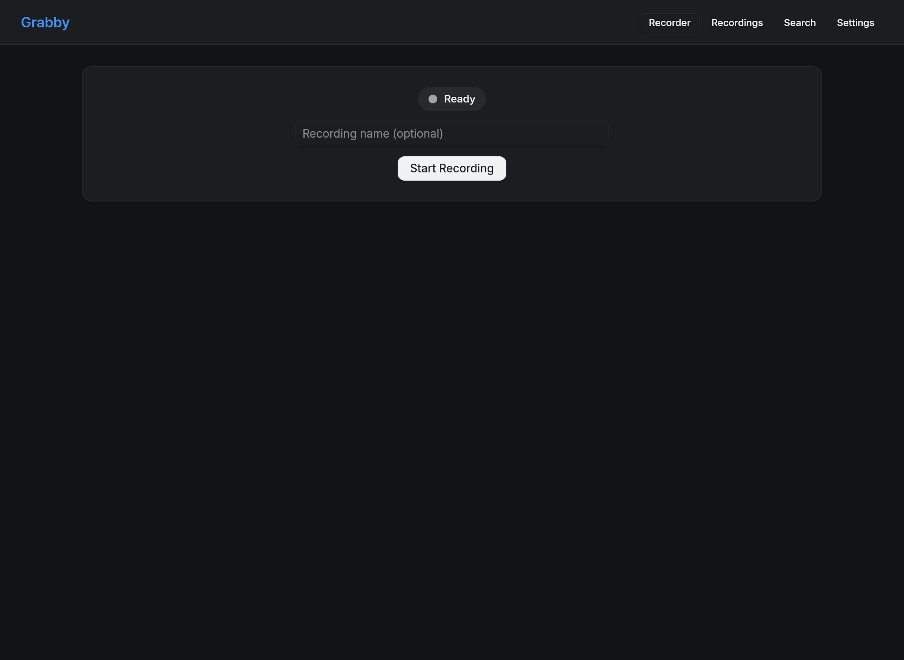

# Grabby



Grabby is a local meeting recorder and transcription app, written in Rust as a native Windows
desktop app. The UI uses [Rune](https://github.com/anomalyco/rune).

It records:

- your microphone audio
- system/meeting audio via WASAPI loopback

Then it lets you:

- see live captions while recording (ElevenLabs realtime STT)
- manage recordings (play, rename, delete)
- transcribe recordings with ElevenLabs Scribe v3, with speaker diarization
- edit transcripts (including speaker renaming) and keep notes per recording
- search across all transcripts with SQLite FTS5
- optionally auto-delete audio and auto-title recordings (see [Recording settings](#recording-settings))
- optionally sync titles, transcripts and notes across devices (see [Text sync](#text-sync))

## Project structure

- `grabby-rust/` — the app (source, `Cargo.toml`, toolchain pin)
- `SYNC.md` — text sync design and receiver API contract
- `research/` — notes and research docs

## Prerequisites

- Windows
- Rust via [rustup](https://rustup.rs); the exact toolchain is pinned in `grabby-rust/rust-toolchain.toml` and installed automatically
- Visual Studio C++ build tools (MSVC toolchain)
- `ffmpeg` on your `PATH` for MP3 export (WAV is used if it is missing)
- ElevenLabs API key

## Build and run

```powershell
cd grabby-rust
cargo run                  # debug build, keeps a console for logs
cargo build --release      # target\release\grabby.exe, no console window
cargo test
```

More detail (configuration, key storage, module layout) is in [grabby-rust/README.md](grabby-rust/README.md).

## API keys

Enter keys in **Settings > API keys**. They are encrypted with Windows DPAPI for the current user
and stored in `configs.dat` in the data folder (`%LOCALAPPDATA%\Grabby`, or `GRABBY_DATA_DIR`).

| Key | Used for |
| --- | --- |
| ElevenLabs | Required: live captions and transcription |
| OpenRouter | Optional: Auto title |
| Text sync | Optional: Bearer token for your sync endpoint |

## Recording settings

Open **Settings** to enable either option (both are off by default and persist in SQLite):

- **Auto-delete audio:** removes the audio only after a successful transcription has been saved. Transcript-only entries stay in Recordings and Search and can be renamed or deleted. Failed transcription keeps the audio for retry. Existing recordings are not purged when you switch this on.
- **Auto title:** sends up to 24,000 characters of transcript text to OpenRouter using `openai/gpt-5.6-luna` and applies an editable display title. Recording identifiers and transcript links stay stable. Missing keys or provider failures keep the original title and show an error on the recording.

Settings apply when a transcription job begins. Rename changes the display title rather than the underlying audio filename.

## Text sync

Open **Settings > Text sync** to share titles, transcripts and notes between devices. Audio files never leave the device.

- Enable sync, enter an HTTPS receiving endpoint and API key, then save. The key is stored encrypted (DPAPI) and is never shown again.
- While enabled, the app exchanges changes every 30 seconds; **Sync now** runs it on demand.
- If the same recording was edited on two devices, both versions are kept and you choose which one to keep.
- A local **mock server** mode lets you try sync and simulate another device, conflicts, server failures and rejected keys without a remote endpoint.

The receiver contract and design notes are in [SYNC.md](SYNC.md).

## Troubleshooting

- If MP3 export fails, install `ffmpeg` and ensure it is on `PATH`.
- If transcription fails, check the ElevenLabs key in **Settings > API keys**.
- If the build fails on an older compiler, let rustup install the pinned toolchain (run `cargo` from inside `grabby-rust/`).
