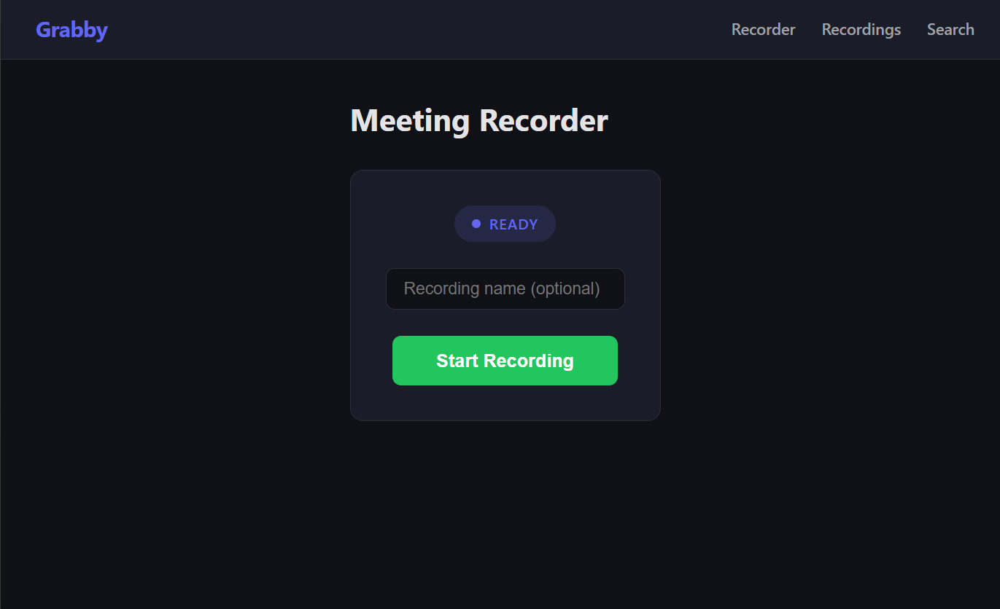

# Grabby




Grabby is a local meeting recorder + transcription app.

It records:
- your microphone audio
- system/meeting audio via WASAPI loopback

Then it lets you:
- manage recordings (play, rename, delete)
- transcribe recordings with ElevenLabs Scribe v2
- edit transcripts (including speaker renaming)
- search across all transcripts with SQLite FTS5

## Tech Stack

- **Backend:** FastAPI (Python)
- **Frontend:** Preact + Vite (TypeScript)
- **Database:** SQLite (`grabby-backend/grabby.db`) with FTS5

## Project Structure

- `grabby-backend/` — FastAPI API + recorder + transcription logic
- `grabby-front/` — Preact web app
- `grabby-backend/recordings/` — saved `.mp3` / `.wav` files
- `research/` — notes and research docs

## Prerequisites

- Windows (WASAPI loopback recording)
- Python 3.13+
- Node.js 20.19+ or 22.12+ (required by Vite 8)
- npm
- `ffmpeg` on your `PATH` (recommended for MP3 export)
- ElevenLabs API key (`ELEVENLABS_API_KEY`)

## 1) Backend Setup (FastAPI)

Open a terminal in `grabby-backend/`.

### Install dependencies

If you already use `grabby-backend/.venv`, activate it and install:

```powershell
.venv\Scripts\Activate.ps1
pip install -r requirements.txt
```

If `.venv` does not exist yet:

```powershell
python -m venv .venv
.venv\Scripts\Activate.ps1
pip install -r requirements.txt
```

### Configure environment

Create `grabby-backend/.env` with:

```env
ELEVENLABS_API_KEY=your_key_here
# Optional, for automatic titles
OPENROUTER_API_KEY=your_openrouter_key_here
```

### Run backend

```powershell
.venv\Scripts\uvicorn app.main:app --reload --port 8000
```

Backend URL: `http://localhost:8000`

## 2) Frontend Setup (Preact)

Open a second terminal in `grabby-front/`:

```powershell
npm install
npm run dev
```

Frontend URL (Vite): usually `http://localhost:5173`

The frontend calls the backend at `http://localhost:8000/api`.

## Main API Endpoints

- `GET /api/status` — recorder status
- `POST /api/start` — start recording
- `POST /api/stop` — stop recording
- `GET /api/recordings` — list recordings
- `PATCH /api/recordings/{filename}` — rename recording
- `DELETE /api/recordings/{filename}` — delete recording
- `POST /api/recordings/{filename}/transcribe` — start transcription
- `GET /api/recordings/{filename}/transcription` — get transcription status/content
- `PUT /api/recordings/{filename}/transcription` — update transcript text
- `GET /api/transcriptions/search?q=...` — full-text transcript search

## Build Frontend for FastAPI Static Hosting (Optional)

If you want FastAPI to serve the built frontend:

1. Build frontend in `grabby-front/`:

```powershell
npm run build
```

2. Start backend as usual:

```powershell
cd ../grabby-backend
.venv\Scripts\uvicorn app.main:app --reload --port 8000
```

When `grabby-front/dist` exists, FastAPI serves the SPA and assets.

## Troubleshooting

- If MP3 export fails, install `ffmpeg` and ensure it is on `PATH`.
- On Python 3.13+, keep `audioop-lts` installed (already in `requirements.txt`).
- If transcription fails, verify `ELEVENLABS_API_KEY` in `grabby-backend/.env`.
- If PowerShell blocks activation scripts, run:

```powershell
Set-ExecutionPolicy -Scope Process -ExecutionPolicy Bypass
```

## Recording settings

Open **Settings** to enable either option (both are off by default and persist in SQLite):

- **Auto-delete audio:** removes the audio only after a successful transcription has been saved. Transcript-only entries stay in Recordings and Search and can be renamed or deleted. Failed transcription keeps the audio for retry. Existing recordings are not purged when you switch this on.
- **Auto title:** sends up to 24,000 characters of transcript text to OpenRouter using `openai/gpt-5.6-luna` and applies an editable display title. Recording identifiers and transcript links stay stable. Missing keys or provider failures keep the original title and show an error on the recording.

Set `OPENROUTER_API_KEY` in `grabby-backend/.env` and restart the backend. The key is never sent to the frontend. Settings apply when a transcription job begins. Rename now changes the display title rather than the underlying audio filename.

Settings API: `GET /api/settings`, `PUT /api/settings` with `auto_delete_audio` and `auto_title` booleans.
